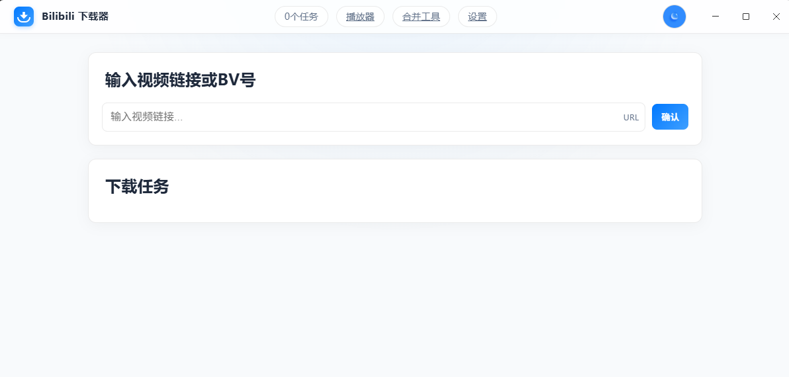

# bilibili-downloader  B站视频下载器

## 2026.10.21 WE HAVE A PROBLEM
v1.0.3 以前的版本有已知的中间人攻击风险，请勿继续使用

开箱即用的 BiliBili 下载器  
本项目是一个基于 Node.js 和 Electron 构建的跨平台BiliBili下载工具，支持所有主流操作系统。


## 🔧 功能
### 已经实现功能
* 视频下载
* 分P视频下载
* 弹幕下载
* 封面下载
* 合集下载
* 多线程下载
* 下载 CDN 与播放 CDN 分离设置：播放 CDN 与预览多线程开关作用于封面预览和分P连续播放器
* 工具箱中的分P连续播放：输入 BV 号、B站视频链接或 b23.tv 短链接，按总时长定位并连续播放各分P，同时加载各分P弹幕。下一P会提前缓冲，切换效果仍取决于网络与解码器；受限视频需要相应的登录权限。
* 工具箱中的 DD 监控室：最多 9 路直播画面同时播放，内嵌滚动 / 底部弹幕与醒目留言，可把任一画面弹出为独立弹幕姬窗口。
* 工具箱中的弹幕姬：输入直播间号、短号或直播间链接（可一次粘贴多个），同时接收最多 12 个直播间的实时弹幕。每个直播间独占一栏，也可切换到按时间合并的时间线；右侧面板可即时调节字号、行距、分栏数、勋章 / 荣耀等级 / SC / 进场 / 礼物显示、时间戳、大航海高亮、关键词与屏蔽词；支持暂停、拖动排序、弹出独立窗口、导出文本与撤销移除。“只看醒目留言”仅临时隐藏非 SC 消息，关闭后恢复缓存中的消息（最多 10000 条），其他过滤条件仍然生效。弹幕连接与 DD 监控室共享，不会重复占用。
* 收藏直播间：点击已接入房间或最近接入记录旁的星标收藏，侧栏收藏列表支持一键接入和取消收藏；收藏保存在本地 Local Storage，不随房间移除或最近记录更新而删除。
* 字幕下载
* 下载任务管理
  * 右键任务可暂停 / 恢复：暂停后自动下载后续任务，恢复时重新获取下载链接并续传；若资源发生变化或服务器不支持续传，则重新下载。
  * 未完成任务及下载断点会保存在本地；重启后恢复任务列表，需手动右键“恢复下载”，不会自动开始。
  * 下载中遇到链接鉴权失败或超过有效期时，自动刷新链接并续传，每次任务执行最多刷新 2 次；持续无权限或资源已删除时明确报错，不影响后续任务。
  * 临时文件在文件名末尾、扩展名前添加任务 UID（如 `标题_audio_UID.m4s`）；成品保留原标题，重名时添加 ` (2)` 等序号。弹幕、封面或字幕失败不会阻塞后续视频任务。
* 暗色主题
* 从收藏夹下载
* 从历史记录下载
* 登录后悬停头像查看头像框、账户、等级和关注等信息；数据启动时预加载，缓存超过 5 分钟后再次悬停时刷新

### 开发中功能
* 下载历史
* 风控验证码
* 同步弹幕屏蔽规则
* ASS 字幕整合弹幕
* 专栏下载


### 实验性功能
* Windows on ARM 支持
* 弹窗从触发按钮展开 / 收回的过渡动画（设置 → 主题 → 实验性，默认开启）


## ⚡ 快速体验

### Windows
从 Release 中下载 bilibili.Setup.x.x.x.exe 后执行正常安装流程即可  
Windows 已经经实验性支持 ARM64 暂无设备测试，可下载 arm 专用包

### Linux
#### 从 Release 中下载支持的发行版包，目前支持：
rpm  
deb  
AppImage  
#### Linux支持多种架构
amd64  
arm64  
~~armv7l（仅 AppImage）~~

### Mac
MAC 版本无签名，需要命令行处理或从本地开发环境运行
#### 从Release下载并使用命令行处理
**1. 下载ZIP软件包，方便后续处理**  
注意区分Intel版和AppleSilicon（ARM64）版本  
Apple芯片版  
  
Intel版  
  
**2. 解压ZIP获取.app包**  
**3. 使用命令行去除互联网下载标签**  
输入（注意空格）
``` bash
xattr -cr 
```
后拖入.app 包并回车  
**4. 移入Application并且开始使用**  
#### 从本地开发环境运行
见教程


## 🚀 本地开发环境运行指南
### 🛠️ 环境准备 (Prerequisites)
在开始之前，请确保你的开发环境已安装以下软件：

* **Node.js**: 推荐使用 [LTS 版本](https://nodejs.org/) (v22.x)。
* **Git**: 用于克隆项目仓库。（可选从Github下载ZIP）

### 📥下载项目
#### 使用git
``` bash
cd path/to/your/folder
git clone https://github.com/excpu/bilibili-downloader.git
cd bilibili-downloader
```
#### 使用ZIP
解压ZIP
``` bash
cd bilibili-downloader
```

### 📦安装依赖
``` bash
npm install
```

### ▶️开发环境运行或自己打包
#### 开发环境运行
``` bash
npm run start
```
#### 自行打包
``` bash
npm run build
```
打包后文件会出现在 dist 目录中

## 🐞 Bug、意见反馈和帮助
### Bug
使用Issue并添加 bug TAG
### 功能意见
使用Issue并添加 enhancement TAG
### 需要帮助
使用Discussion功能发布帮助请求
#
**额外申明**  
该项目仅供学习研究使用，请勿用于非法用途  
项目仅用于可用BiliBili客户端缓存的视频，不支持版权内容的下载  
联系删除：contact@5share.site